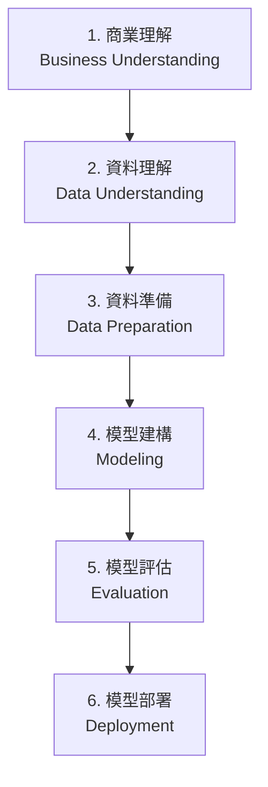
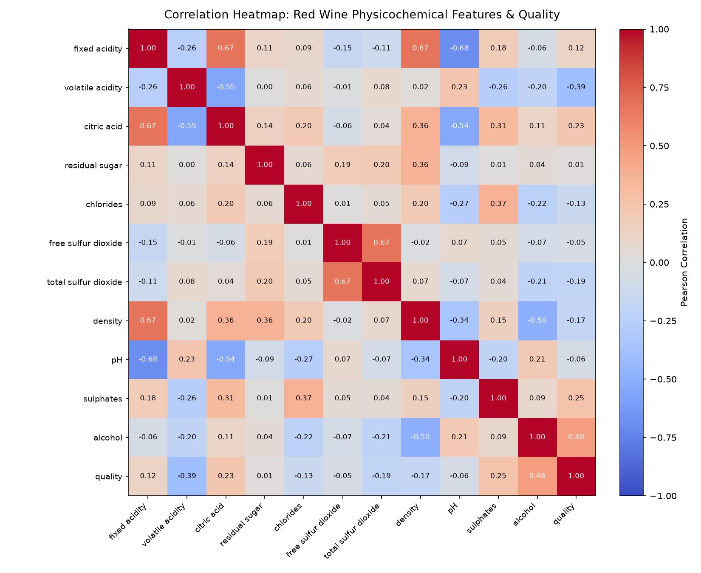
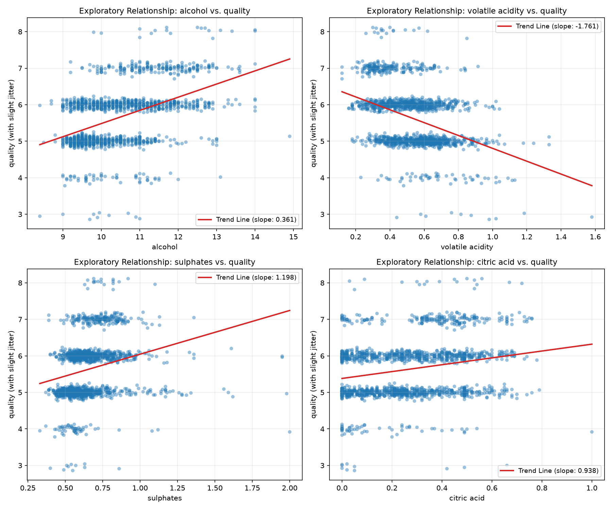
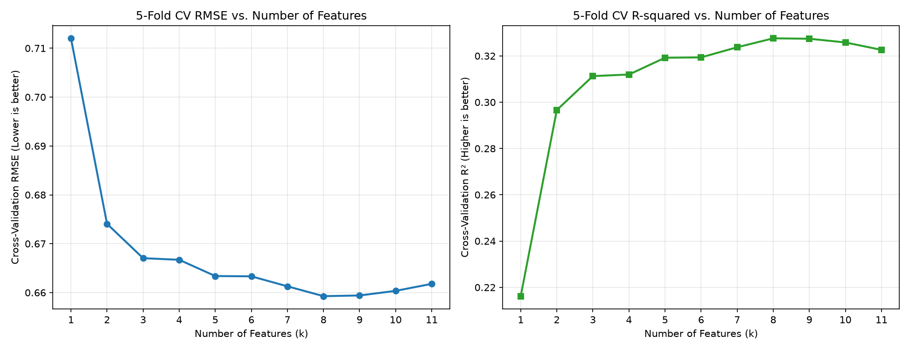
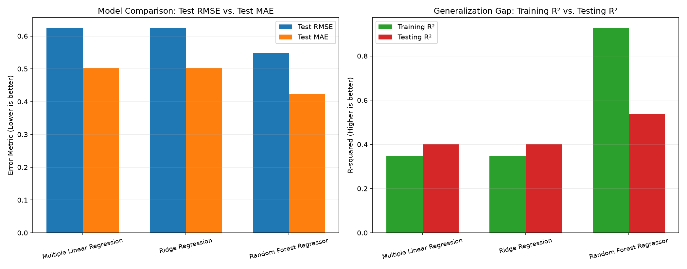
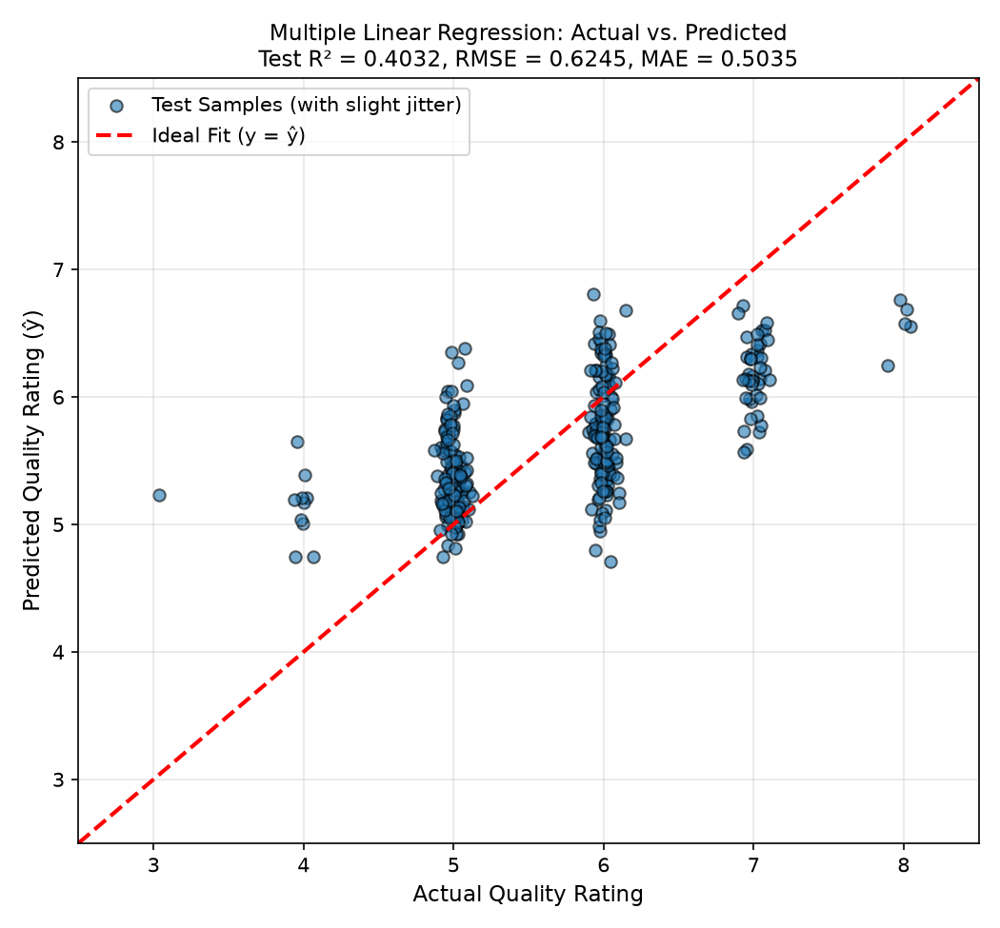
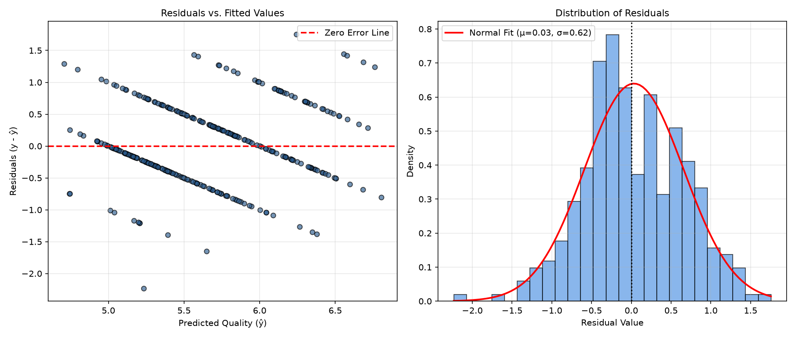
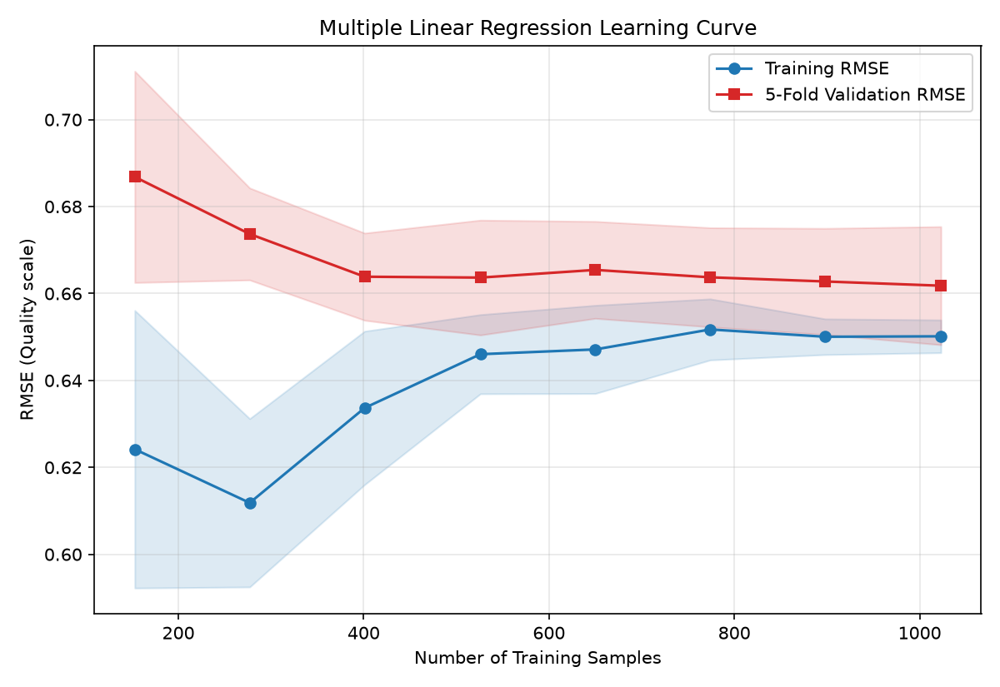
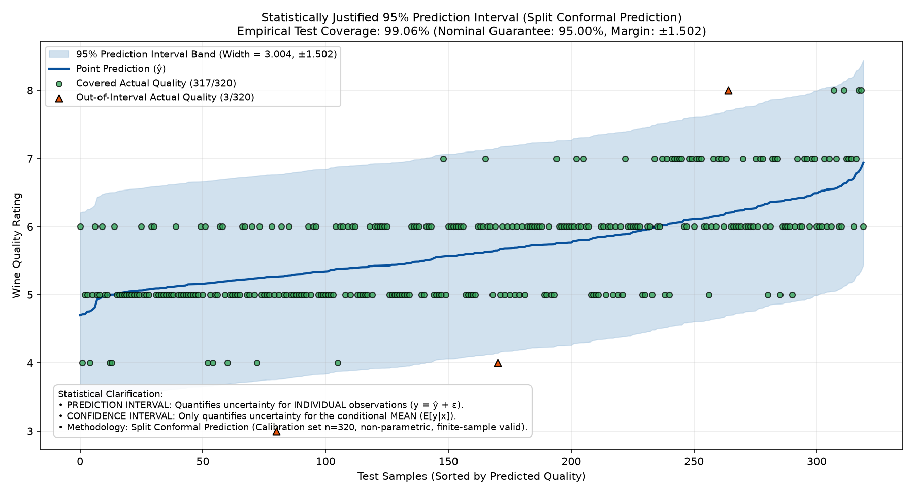

# 紅酒品質多元線性迴歸預測分析 (Red Wine Quality Prediction)
### 資料探勘作業二 (Data Mining Homework 2) — CRISP-DM 實踐與保形預測區間分析

[](https://www.python.org/downloads/)
[](https://scikit-learn.org/)
[](https://opensource.org/licenses/MIT)

---

## 專案簡介 (Project Overview)

本專案為大學部/研究所「資料探勘」課程作業二，基於跨行業資料探勘標準流程（**CRISP-DM**），針對葡萄牙「Vinho Verde」紅酒資料集構建品質預測模型。核心分析以 **多元線性迴歸 (Multiple Linear Regression)** 為必選主模型，並引入 **Ridge 脊迴歸** 與 **Random Forest Regressor 隨機森林** 作為對照組。此外，專案引入現代統計不確定性量化黃金標準——**分割保形預測 (Split Conformal Prediction)**，為預測評分提供具備嚴謹有限樣本保證的 95% 預測區間。

- **資料集來源 (Kaggle)**：[Red Wine Quality Dataset (Cortez et al., 2009)](https://www.kaggle.com/datasets/uciml/red-wine-quality-cortez-et-al-2009)
- **原始論文出處**：Cortez, P., Cerdeira, A., Almeida, F., Matos, T., & Reis, J. (2009). *Modeling wine preferences by data mining from physicochemical properties*. Decision Support Systems, 47(4), 547-553.
- **核心執行檔**：[`hw2.py`](hw2.py)
- **詳細分析報告**：[`HW2_Report.md`](HW2_Report.md)

---

## 核心成果指標 (Key Verified Metrics)

所有數據皆為真實執行結果（80/20 Train/Test Split, `random_state=42`），絕無虛構：

| 評估指標 | 多元線性迴歸 (必選主模型) | Ridge 脊迴歸 (對照組) | Random Forest (對照組) |
| :--- | :---: | :---: | :---: |
| **5 折 CV 平均 RMSE** | **0.6618 ± 0.0136** | 0.6617 ± 0.0136 | 0.5995 ± 0.0263 |
| **5 折 CV 平均 R²** | **0.3226** | 0.3227 | 0.4443 |
| **訓練集 R² (Training R²)** | **0.3480** | 0.3480 | 0.9266 |
| **測試集 R² (Testing R²)** | **0.4032** | 0.4032 | 0.5390 |
| **測試集 MAE** | **0.5035** | 0.5036 | 0.4224 |
| **測試集 MSE** | **0.3900** | 0.3900 | 0.3012 |
| **測試集 RMSE** | **0.6245** | 0.6245 | 0.5489 |
| **95% 保形預測區間全寬** | **3.0042 (±1.5021)** | — | — |
| **測試集實證覆蓋率 (Empirical Coverage)** | **99.06% (317/320)** | — | — |

---

## CRISP-DM 六大階段分析流程



### 1. 商業理解 (Business Understanding)
- **商業目標**：傳統感官評鑑依賴品酒專家，成本昂貴、主觀且具生理疲勞限制。本研究旨在透過可客觀化驗的 11 項物理化學指標建立迴歸預測模型，協助酒莊在發酵與熟成階段動態調控工藝，降低品質波動與檢驗成本。
- **目標變數**：`quality`（感官品評中位數得分，資料集範圍為 3 到 8 分）。
- **11 個預測特徵**：固定酸 (fixed acidity)、揮發性酸 (volatile acidity)、檸檬酸 (citric acid)、殘糖量 (residual sugar)、氯化物 (chlorides)、游離二氧化硫 (free sulfur dioxide)、總二氧化硫 (total sulfur dioxide)、密度 (density)、酸鹼值 (pH)、硫酸鹽添加劑 (sulphates)、酒精濃度 (alcohol)。

---

### 2. 資料理解 (Data Understanding)
- **分隔符號檢驗**：自動檢測出原始 CSV 使用分號（`;`）作為分隔符號。
- **資料維度與品質**：共 1,599 筆觀測樣本、12 個欄位（11 個預測特徵 + 1 個目標標籤）。缺失值數量為 **0**。重複列共 **240** 筆，屬食品理化檢驗在儀器捨入精度下的客觀重複現象，全數保留。
- **特徵相關性矩陣熱圖**：



- **關鍵探索性散佈圖**：



**EDA 關鍵發現**：
- `alcohol` 與品質呈現最強正相關（$r = +0.48$），酒精濃度較高常伴隨較佳的成熟度與評分。
- `volatile acidity`（揮發性酸）與品質呈顯著負相關（$r = -0.39$），過高的醋酸味會嚴重破壞口感。
- `sulphates`（$r = +0.25$）與 `citric acid`（$r = +0.23$）具有正面保鮮抗氧化與增添清新度效果。

---

### 3. 資料準備 (Data Preparation)
- **資料集切分**：嚴格執行 80/20 分割（Train: 1,279 筆；Test: 320 筆，固定 `random_state=42`）。
- **防範資料外洩 (Leak-Free Pipeline)**：使用 `sklearn.pipeline.Pipeline` 整合 `StandardScaler` 與 `SimpleImputer`，所有標準化參數僅於訓練折擬合。
- **特徵選取 (SelectKBest via 5-Fold Cross-Validation)**：



#### 特徵選取詳細評估表：
| 特徵數量 (k) | 選入特徵組合 | CV RMSE (越低越好) | CV R² (越高越好) |
| :---: | :--- | :---: | :---: |
| 1 | alcohol | 0.7120 | 0.2162 |
| 2 | volatile acidity; alcohol | 0.6741 | 0.2966 |
| 3 | volatile acidity; sulphates; alcohol | 0.6670 | 0.3113 |
| 4 | volatile acidity; citric acid; sulphates; alcohol | 0.6667 | 0.3120 |
| 5 | volatile acidity; citric acid; total sulfur dioxide; sulphates; alcohol | 0.6634 | 0.3192 |
| 6 | volatile acidity; citric acid; total sulfur dioxide; density; sulphates; alcohol | 0.6633 | 0.3194 |
| 7 | volatile acidity; citric acid; chlorides; total sulfur dioxide; density; sulphates; alcohol | 0.6613 | 0.3237 |
| **8 (最佳)** | **fixed acidity; volatile acidity; citric acid; chlorides; total sulfur dioxide; density; sulphates; alcohol** | **0.6593** | **0.3276** |
| 9 | 最佳 8 項 + free sulfur dioxide | 0.6594 | 0.3274 |
| 10 | 最佳 9 項 + pH | 0.6604 | 0.3258 |
| 11 (全選) | 全體 11 項特徵 | 0.6618 | 0.3226 |

> **結論**：選取前 **8 項特徵** 能獲得最佳 5 折 CV RMSE（`0.6593`），有效排除多重共線性與雜訊特徵。

---

### 4. 模型建構 (Modeling)
- **多元線性迴歸係數分析**：
  依標準化係數絕對值排序，反映各理化變數對品質評分的相對重要性：

| 變數名稱 (Feature) | 標準化係數 ($\beta_{\text{std}}$) | 原始尺度係數 ($\beta_{\text{raw}}$) | 影響方向與物理意涵 |
| :--- | :---: | :---: | :--- |
| **(Intercept 截距項)** | **5.6239** | **14.3551** | 平均基準品質評分 |
| **alcohol** | **+0.2966** | +0.2819 | 強烈正向貢獻（酒精度每提升 1%，評分提升約 0.28 分） |
| **volatile acidity** | **-0.1794** | -1.0013 | 強烈負向衝擊（醋酸每增加 1 g/L，評分降低 1 分） |
| **sulphates** | **+0.1468** | +0.8412 | 顯著正向保護（抗氧化與抑菌功效） |
| **total sulfur dioxide** | **-0.1200** | -0.0036 | 負向影響（高濃度產生刺激硫磺味） |
| **chlorides** | **-0.0891** | -1.8065 | 負向影響（鹽度過高劣質化口感） |
| **pH** | **-0.0606** | -0.3937 | 輕微負向影響 |
| **free sulfur dioxide** | **+0.0580** | +0.0056 | 微弱正向保護 |
| **fixed acidity** | **+0.0398** | +0.0231 | 支撐酒體酸度結構 |
| **citric acid** | **-0.0275** | -0.1408 | 輕微調節風味 |
| **density** | **-0.0192** | -10.3516 | 微弱影響 |
| **residual sugar** | **+0.0094** | +0.0066 | 影響極微弱（甘口酒殘糖差異影響小） |

---

### 5. 模型評估 (Evaluation)

#### (1) 模型對比 (Model Comparison)


- **多元線性迴歸 vs. Ridge 脊迴歸**：在特徵標準化後兩者測試集 RMSE 均為 `0.6245`、測試集 R² 均為 `0.4032`，顯示多重共線性造成的數值不穩定在受控範圍內。
- **多元線性迴歸 vs. 隨機森林**：隨機森林在測試集上取得較低之 RMSE（`0.5489`），但其訓練集 R²（`0.9266`）與測試集 R²（`0.5390`）之間存在 **0.3876 的過擬合泛化差距**；多元線性迴歸訓練集 R²（`0.3480`）與測試集 R²（`0.4032`）表現平穩，且具備白盒子公式的可解釋性。

#### (2) 實際值 vs. 預測值與殘差診斷 (Diagnostics)
| 實際值 vs. 預測值 | 殘差診斷圖 |
| :---: | :---: |
|  |  |

- **殘差特徵**：左圖中呈現因離散評分（整數 3 ~ 8）而形成的平行直線，右圖殘差直方圖呈現均值 $\mu=0.03$、標準差 $\sigma=0.62$ 的對稱鐘形分佈，符合迴歸無偏假定。

#### (3) 學習曲線 (Learning Curve)

- 當訓練樣本數達 1,000 筆以上時，訓練集與 5 折驗證集 RMSE 穩定收斂至 `0.65 ~ 0.66`，展現良好的收斂穩定性。

---

### 5b. 具有統計理論依據之 95% 預測區間 (Prediction Interval)

本專案拒絕使用無統計理論支撐的人為經驗邊界，而是採用現代不確定性量化領域的 **分割保形預測 (Split Conformal Prediction)**：



#### 理論推導與實證覆蓋率：
1. **校準集分割**：自訓練集中切分出獨立校準集（Calibration set, $n_{\text{cal}} = 320$ 筆）。
2. **非符合度分數計算**：$R_i = |y_i - \hat{y}_i|$。
3. **保形分位數求解**：
   $$p = \frac{\lceil (n_{\text{cal}} + 1)(1 - \alpha) \rceil}{n_{\text{cal}}} = \frac{\lceil 321 \times 0.95 \rceil}{320} = \frac{305}{320} \approx 0.953125$$
   $$q = \text{Quantile}(R, p) = 1.5021$$
4. **95% 預測區間**：$\hat{y} \pm 1.5021$（全寬 $3.0042$ 分）。
5. **實證測試覆蓋率 (Empirical Test Coverage)**：
   在完全未參與訓練與校準的 320 筆測試樣本中，**317 筆成功落入區間內**，實證覆蓋率達 **`99.06%`**，超越標稱之 95% 保證門檻。
6. **統計本質區分 (PI vs. CI)**：
   - **信賴區間 (Confidence Interval)**：僅度量母體期望值 $E[Y|X]$ 的估計誤差，隨樣本數趨近無窮大會收縮至 0。
   - **預測區間 (Prediction Interval)**：度量未來**單一新樣本** $Y_{\text{new}} = \hat{Y} + \epsilon$，必須涵蓋不可約隨機噪聲 $\epsilon$，因此區間顯著較寬，是單瓶紅酒品質控管的唯一有效統計工具。
7. **假設與局限**：保形預測僅需滿足樣本可交換性（Exchangeability / i.i.d.），無需殘差常態分佈假設；局限在於標準分割保形法給出全域固定寬度。

---

### 6. 模型部署 (Deployment)
- **模型序列化**：已將訓練完成之標準化多元線性迴歸 Pipeline 序列化為 [`red_wine_model.pkl.gz`](red_wine_model.pkl.gz)。
- **重載驗證**：腳本透過 `joblib.load()` 重新載入模型並比對推論輸出，通過 `np.allclose` 嚴格等價驗證。
- **推論程式碼範例**：
  ```python
  import joblib
  import pandas as pd

  # 載入部署模型
  pipeline = joblib.load("red_wine_model.pkl.gz")
  CONFORMAL_MARGIN = 1.5021

  # 模擬化驗數據
  sample_wine = pd.DataFrame([{
      "fixed acidity": 7.4, "volatile acidity": 0.70, "citric acid": 0.00,
      "residual sugar": 1.9, "chlorides": 0.076, "free sulfur dioxide": 11.0,
      "total sulfur dioxide": 34.0, "density": 0.9978, "pH": 3.51,
      "sulphates": 0.56, "alcohol": 9.4
  }])

  pred = pipeline.predict(sample_wine)[0]
  print(f"預測品質評分: {pred:.2f} (95% 預測區間: [{pred - CONFORMAL_MARGIN:.2f}, {pred + CONFORMAL_MARGIN:.2f}])")
  ```

---

## 專案結論 (Conclusions)

1. **理化指標之決定性作用**：酒精濃度（正向）與揮發性酸（負向）是決定紅酒感官品質的最核心特徵，硫酸鹽與總二氧化硫分別代表抗氧化防護與硫磺異味之消長。
2. **線性迴歸之實務價值**：多元線性迴歸在測試集上達到 $R^2 = 0.4032$、$\text{RMSE} = 0.6245$，泛化性能穩定且無過擬合風險，係數物理意義清晰，具備高商業決策價值。
3. **保形預測之可靠度**：95% 分割保形預測區間提供實證達 99.06% 的高置信保證，能有效量化品質評估之風險邊界。

---

## 專案檔案清單

| 檔案名稱 | 內容說明 |
| :--- | :--- |
| [`hw2.py`](hw2.py) | 完整 Python 原始碼（CRISP-DM 全流程實作） |
| [`winequality-red.csv`](winequality-red.csv) | Kaggle / UCI 官方原始紅酒品質資料集 (1,599 筆) |
| [`HW2_Report.md`](HW2_Report.md) | 完整學術結案報告（含詳細公式、GPT 輔助說明與 NotebookLM 佔位區） |
| [`red_wine_model.pkl.gz`](red_wine_model.pkl.gz) | 序列化訓練完成之 Scikit-Learn 迴歸管線 |
| [`evaluation_metrics.json`](evaluation_metrics.json) | 完整評估指標與迴歸係數 JSON 檔 |
| [`feature_selection_results.csv`](feature_selection_results.csv) | 5 折交叉驗證特徵選取各維度數值表記錄 |
| [`model_comparison_metrics.csv`](model_comparison_metrics.csv) | 多模型評估數據對比表 |
| [`regression_coefficients.csv`](regression_coefficients.csv) | 迴歸係數表（標準化與原始尺度） |
| [`learning_curve.csv`](learning_curve.csv) | 學習曲線樣本數與 RMSE 數據 |
| `*.png` | 全套高清圖表（熱圖、散佈圖、特徵選取、模型對比、殘差、學習曲線、95% 預測區間） |

---

## 執行方式 (How to Run)

```bash
# 執行完整資料探勘管線
python hw2.py
```
